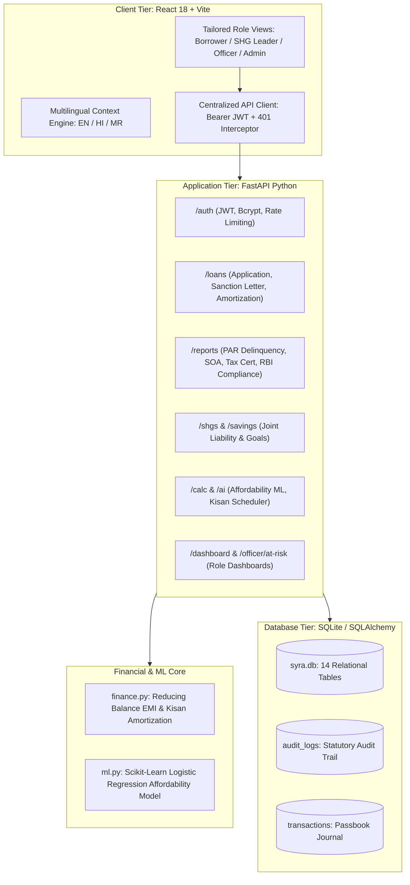

# System Architecture Documentation: FinanceSaathi / SYRA

## 1. High-Level Architectural Overview

FinanceSaathi / SYRA is designed as a secure, full-stack microfinance, SHG community management, and multilingual financial literacy platform tailored for rural and semi-urban households in India.

---

## 2. Technology Stack & Component Responsibilities

### 2.1 Frontend Tier (`frontend/`)
- **React 18 & Vite:** High-performance single-page architecture with fast hot-module replacement and optimized asset packaging.
- **Role Perspective Switcher:** 1-click persona switcher (`RolePerspectiveSwitcher` in `App.jsx`) allowing instant preview across demo personas (Amit Wadar, Pooja Patil, Sunita Kamble, Ramesh Deshmukh, Rajesh Sharma).
- **Localization Engine (`i18n.jsx`):** Tri-lingual state provider dynamically switching language across English (`en`), Hindi (`hi`), and Marathi (`mr`).
- **Media-Inspired Rural Design System (`styles.css`):** Deep emerald palette (`#064e3b` to `#047857`), sparkline balance cards, SVG speedometers, touch-friendly tables, and dark mode support (`data-theme="dark"`).

### 2.2 Backend Application Tier (`backend/app/`)
- **FastAPI:** High-performance asynchronous REST API framework with automated OpenAPI / Swagger documentation (`/docs`).
- **Authentication & RBAC (`deps.py`, `security.py`, `auth.py`):**
  - Standard user registration creates `role="user"`.
  - Roles: `user` (Borrower), `shg_leader` (SHG Group Desk), `officer` (Credit Underwriter), `admin` (System Administrator).
  - RBAC strictly enforced server-side via `require_roles()` dependency.
- **Financial Mathematical Engine (`finance.py`):**
  - Reducing Balance EMI formula: \(E = P \cdot r \cdot \frac{(1+r)^n}{(1+r)^n - 1}\)
  - Agricultural Kisan Harvest Schedule: Maintenance interest in gestation months, post-harvest lumpsum principal bullets following mandi crop sales.
  - Sahukar Moneylender Trap Detector: Effective APR calculation on cash in hand after upfront cutbacks.
- **Machine Learning Affordability Module (`ml.py`):**
  - Scikit-learn `LogisticRegression` evaluating FOIR, EMI-to-disposable income, savings coverage, and expense ratio.
  - Generates transparent feature contributions (`helps` / `hurts`) for decision support. Final loan sanctions require human officer review.

### 2.3 Relational Data Persistence Tier (`models.py`, `database.py`)
- **SQLAlchemy 2.0:** Object-relational mapping with type-annotated models.
- **Active Database:** Local SQLite database at `backend/syra.db` (14 tables).
- **Immutable Audit Trail:** `AuditLog` records actor ID, action type, target entity, and timestamp for all critical financial events.
- **Passbook Journal:** `Transaction` table maintaining double-entry credit/debit records with category, payment mode, and reference IDs.
