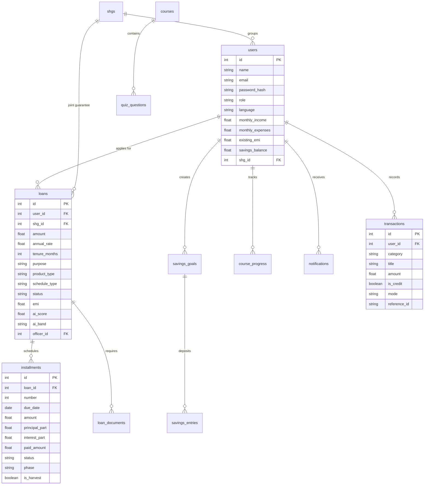

# Database Schema & Data Preservation Guide: FinanceSaathi / SYRA

## 1. Database Configuration & Active File

- **Active Database File:** `d:\syra\backend\syra.db` (139,264 bytes)
- **Active Connection String:** Configured via `DATABASE_URL` in `backend/app/config.py` defaulting to `sqlite:///./syra.db`.
- **Legacy Database Note:** `financesaathi.db` is an empty 0-byte file in `backend/` preserved for legacy naming backwards compatibility.
- **Verified Backup File:** `backend/backups/syra_backup_verified.db` (139,264 bytes).
- **Automated Backup Script:** `backend/scripts/backup_db.py`.

---

## 2. Relational Schema & Entity Relationships

---

## 3. Table Catalog & Record Counts (Verified)

| Table | Count | Key Fields | Purpose |
| :--- | :--- | :--- | :--- |
| `users` | 9 | `id, name, email, role, savings_balance, shg_id` | Core user accounts across all roles |
| `shgs` | 1 | `id, name, village, leader_id` | Self-Help Groups (joint-liability credit) |
| `loans` | 5 | `id, user_id, amount, annual_rate, status, product_type, schedule_type` | Microfinance credit facilities |
| `installments` | 36 | `id, loan_id, number, due_date, amount, principal_part, phase, is_harvest` | Amortization installments |
| `loan_documents` | 5 | `id, loan_id, doc_type, verified` | KYC documents checklist |
| `savings_goals` | 3 | `id, user_id, title, target_amount, saved_amount` | Household savings targets |
| `savings_entries` | 0 | `id, goal_id, amount, created_at` | Sub-entries for goal deposits |
| `transactions` | 14 | `id, user_id, category, title, amount, is_credit, mode` | Digital passbook journal entries |
| `courses` | 9 | `id, slug, language, title, summary, content` | Multilingual financial education courses |
| `quiz_questions` | 18 | `id, course_id, question, options, answer_index` | Interactive assessment questions |
| `course_progress` | 0 | `id, user_id, course_slug, best_score, completed` | User learning course completion |
| `schemes` | 9 | `id, name, language, description, eligibility, url` | Government subsidies and welfare schemes |
| `notifications` | 1 | `id, user_id, message, read, created_at` | System and reminder notifications |
| `audit_logs` | 6 | `id, actor_id, action, entity, entity_id, detail` | Statutory immutable audit log entries |

---

## 4. Preservation & Migration Guidelines

1. **Never Overwrite or Reset:** Never drop tables or delete `syra.db` to solve migration or startup issues.
2. **Reversible Schema Alterations:** Use PRAGMA column checks in `main.py` before executing `ALTER TABLE ADD COLUMN`.
3. **Backup Before Mutation:** Always execute `python backend/scripts/backup_db.py` prior to running schema changes.
