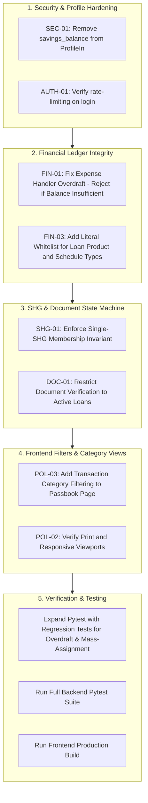

# Dependency-Ordered Implementation Plan: SYRA / FinanceSaathi

**Plan Timestamp:** 2026-10-13T06:51:00+05:30  
**Architect:** Senior Full-Stack Engineer & Financial Systems Specialist  

---

## 1. Dependency-Ordered Execution Phases



---

## 2. Detailed Task Breakdown

### Task 1: Eliminate Mass-Assignment of `savings_balance` (P0: SEC-01)
- **Target File:** `backend/app/schemas.py`
- **Action:** Remove `savings_balance` from `ProfileIn`. Only `monthly_income`, `monthly_expenses`, `existing_emi`, `name`, `phone`, and `language` may be updated via profile patch.
- **Verification:** Unit test sending `savings_balance` in `PATCH /auth/me` and confirming it does not alter balance.

### Task 2: Fix Expense Handler Overdraft Defect (P0: FIN-01)
- **Target File:** `backend/app/routers/staff.py`
- **Action:** Replace `max(0.0, user.savings_balance - body.amount)` with a strict insufficient-funds guard:
  ```python
  if user.savings_balance < body.amount:
      raise HTTPException(400, f"Insufficient funds: Available balance Rs {user.savings_balance:,.2f} is less than requested expense Rs {body.amount:,.2f}")
  user.savings_balance = round(user.savings_balance - body.amount, 2)
  ```
- **Verification:** Pytest testing expense > balance (HTTP 400), expense == balance (balance 0, HTTP 200), and expense < balance.

### Task 3: Enforce Literal Whitelist on Loan Products & Schedules (P1: FIN-03)
- **Target File:** `backend/app/schemas.py` (`LoanIn`)
- **Action:** Define `ProductType = Literal["standard", "kisan_agri", "pm_mudra", "mahila_shakti", "pm_svanidhi", "emergency_health", "solar_green", "artisan_micro"]` and `ScheduleType = Literal["monthly", "harvest_bullet"]`.
- **Verification:** Test sending invalid schedule type expecting HTTP 422.

### Task 4: Prevent Conflicting SHG Membership (P2: SHG-01)
- **Target File:** `backend/app/routers/community.py` (`add_member`)
- **Action:** Check if `member.shg_id and member.shg_id != shg.id`. If true, raise HTTP 409 Conflict.
- **Verification:** Pytest testing adding a member already belonging to another group.

### Task 5: Restrict Document Verification to Active Loans (P2: DOC-01)
- **Target File:** `backend/app/routers/loans.py` (`verify_document`)
- **Action:** Check if `loan.status not in ("pending", "approved")`. If closed or rejected, raise HTTP 409 Conflict.
- **Verification:** Pytest verifying document verification rejected on closed/rejected loans.

### Task 6: Passbook Category Filtering on Frontend (P3: POL-03)
- **Target File:** `frontend/src/pages/Transactions.jsx`
- **Action:** Add interactive category filter pills (`All`, `Income`, `Expenses`, `EMI Payments`, `Goal Transfers`, `SHG`) to filter passbook table in real-time.
- **Verification:** Production Vite build and manual interaction check.

### Task 7: Comprehensive Regression Test Execution
- **Target File:** `backend/tests/test_api.py`
- **Action:** Append regression tests for all identified P0/P1/P2 items. Execute `pytest backend/tests`.
- **Quality Gate:** 100% tests passing, 0 build errors.
